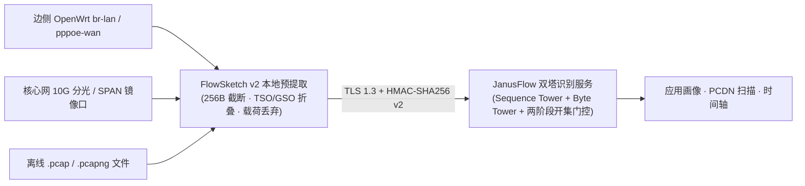

# JanusFlow Probe · 雅努斯流加密流量识别探针

[](https://opensource.org/licenses/Apache-2.0)
[](https://www.python.org/downloads/)
[-brightgreen.svg)](#)

**JanusFlow Probe**（官方品牌域名：`janusflow.cn` · `JanusFlow.net` · `atooli.com`）是 **JanusFlow 双塔加密流量在线识别服务** 的官方开源客户端与探针参考实现：

- **`janusflow-probe` CLI**：PCAP / FlowSketch 上传识别、PCDN 拓扑扫描、单终端时间轴重建、配额对账；
- **FlowSketch v2（`2.0-pa`）本地预提取器**：在内网本地把原始抓包压缩为脱敏流草图（典型压缩比 50~100x），**业务载荷不出内网**；
- **两套开源硬件探针套件**：
  - [`probes/openwrt_edge/`](./probes/openwrt_edge/) — 边侧 OpenWrt 软路由 / 企业分支网关轻量探针（零闪存写入、`procd` 守护）；
  - [`probes/core_10g_tap/`](./probes/core_10g_tap/) — 核心网 10G/40G 光纤分光器（Optical TAP）与交换机 SPAN 镜像探针（网卡卸载审计、`systemd` 模板）。

> 本仓库专注 **流量识别与探针**。移动应用 APK 300s 活体动态检测 CLI 位于独立仓库 [`876387/clawprobe`](https://github.com/876387/clawprobe)。两者共用同一套 JanusFlow 商业 API Key。

100% Python 标准库实现，无第三方依赖，可直接运行在 OpenWrt（`python3-light`）、Ubuntu/Debian 分光采集服务器与 macOS 开发机上。

---

## 一、架构



**FlowSketch v2 支持的链路封装**：Ethernet（`DLT_EN10MB`）、802.1Q VLAN、802.1ad QinQ、PPPoE Session（`0x8864`）、VXLAN（UDP 4789）、Linux SLL / SLL2；输入格式 `.pcap` / `.pcap.gz` / `.pcapng` / `.pcapng.gz`。对网卡 TSO/GSO/GRO 产生的 `>1500B` 超大帧，按单程自适应估计的 MSS 折叠为线上等效分段。

---

## 二、安装

```bash
# 从 GitHub 安装（推荐）
pip install -U "git+https://github.com/876387/janusflow-probe.git"

# 或克隆源码直接运行（探针套件需要完整仓库）
git clone https://github.com/876387/janusflow-probe.git
cd janusflow-probe && pip install -e .

janusflow-probe --version
janusflow-probe doctor          # 无需 API Key：自检 TLS 1.3、证书链与时钟偏移
```

---

## 三、API Key 获取与绑定

识别服务按 **API Key** 计费，与 APK 检测服务共用同一把 Key。前往 [https://www.atooli.com/#pricing](https://www.atooli.com/#pricing) 通过微信/支付宝扫码或兑换码（`CP-XXXX-XXXX-XXXX`）自助开通：

| 套餐 | 元旦前特惠价 | 加密流识别日配额 | PCDN 扫描次数 | 典型场景 |
| :--- | :--- | :--- | :--- | :--- |
| `PAYG_1` | ¥19.9 | 2,000 流/日 | 5 | 离线 PCAP 尝鲜 |
| `PAYG_10` | ¥159 | 15,000 流/日 | 30 | 小型网关周期性画像 |
| `SUB_MONTH` | ¥299 / 月 | 50,000 流/日 | 100 / 月 | 边侧 OpenWrt 探针 7×24 常驻 |
| `SUB_YEAR` | ¥2,699 / 年 | 500,000 流/日 | 1,200 / 年 | 核心网 10G 分光 + 多节点探针 |

```bash
# 方式 A（推荐）：一键订阅串（自动写入 Endpoint、Key、Secret 与 SPKI 指纹）
janusflow-probe auth login --sub cp_sub_v1_xxxxxxxxxxxxxxxx

# 方式 B：显式 Key / Secret（凭据文件权限 0600）
janusflow-probe auth login --api-key cnx_live_xxx --secret sec_xxx

# 方式 C：环境变量（适合探针守护进程与 CI）
export JANUSFLOW_API_KEY="cnx_live_xxx"
export JANUSFLOW_SIGN_SECRET="sec_xxx"

janusflow-probe auth verify
janusflow-probe usage           # 今日剩余流配额 / PCDN 扫描次数
```

---

## 四、CLI 用法

```bash
# 本地预提取（离线，不消耗配额）
janusflow-probe sketch ./gateway.pcap -o ./gateway.v2.fsk.jsonl.gz

# 应用画像（>6MB 自动本地预提取后再上传）
janusflow-probe profile ./gateway.pcap --device-id office-gw01 --local-cidr 10.0.0.0/8

# PCDN 拓扑与上下行包络扫描
janusflow-probe pcdn-scan ./core_tap.pcap.gz --device-id core-tap-01 --local-cidr 10.0.0.0/8

# 时间轴：A) 从抓包文件重建指定终端；B) 查询常驻探针的滑动窗口历史
janusflow-probe timeline ./gateway.pcap --target-ip 10.0.0.25 --out ./timeline.json
janusflow-probe timeline --device-id office-gw01 --window 3600 [--pcdn-only]

# 常驻探针（见 probes/ 下的详细部署文档）
janusflow-probe probe-openwrt --iface br-lan --device-id office-gw01 --interval 60
sudo -E janusflow-probe probe-10g-tap --iface eth1 --device-id core-tap-01 --interval 30 --enforce-offload-off
```

| 命令 | 服务端接口 | 计费 |
| :--- | :--- | :--- |
| `profile` | `POST /api/v2/traffic/profile-period` | 按有效流数扣减当日流配额 |
| `pcdn-scan` | `POST /api/v2/traffic/pcdn-scan` | 每 256 个活跃终端扣 1 次 PCDN 扫描 |
| `timeline <file>` | `POST /api/v2/traffic/timeline` | 按有效流数扣减当日流配额 |
| `timeline --device-id` | `GET /api/v2/traffic/timeline` | 不扣配额 |
| `usage` / `auth verify` | `GET /api/v1/usage/summary` / `GET /api/v1/auth/verify` | 不扣配额 |

所有请求使用 HMAC-SHA256 v2 签名（`METHOD \n 排序后路径+查询 \n 时间戳 \n Nonce \n SHA256(原始请求体)`，±60s 防重放窗口）。

---

## 五、隐私与数据边界

- 探针仅截取每包前 256 字节头部，FlowSketch 仅保留五元组、双向包长/时序序列、前 5 包最多 128B 握手特征与 TLS SNI/ALPN；应用层载荷在本地丢弃；
- 抓包与草图只在内存目录（`/var/run/janusflow`、`/dev/shm`）中滚动，上传后立即删除；
- 请仅在您拥有合法管理权限的网络上部署本探针，并遵守所在地关于网络数据采集与个人信息保护的法律法规。

---

## 六、开发与测试

```bash
python3 -m unittest discover -s tests -v
```

测试覆盖：FlowSketch 往返与 SNI/TSO 折叠、ethtool 卸载校验、HMAC 签名、CLI 子命令边界、两套探针 `--self-test`，以及全仓库内部地址/代号泄露扫描。

## License

Apache-2.0
