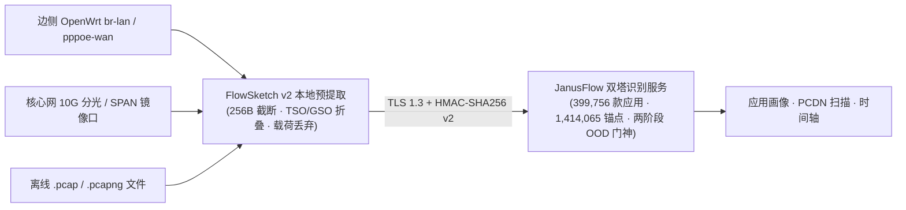

# JanusFlow Probe · 雅努斯流加密流量识别探针

[](https://opensource.org/licenses/Apache-2.0)
[](https://www.python.org/downloads/)
[-brightgreen.svg)](#)

**JanusFlow Probe**（官方品牌域名：`janusflow.cn` · `JanusFlow.net` · `atooli.com`）是 **JanusFlow 双塔加密流量在线识别服务** 的官方开源客户端与探针参考实现：

- **`janusflow-probe` CLI**：PCAP / FlowSketch 上传识别（**支持 `399,756` 款独立应用细粒度归因、`19` 大行业分类、`17` 类第三方 SDK 解耦与两阶段 OOD 未知流拒识**）、**`5` 大商业 PCDN 家族与高上行拓扑扫描**、单终端时间轴重建、配额对账；
- **FlowSketch v2（`2.0-pa`）本地预提取器**：在内网本地把原始抓包压缩为脱敏流草图（典型压缩比 50~100x），**业务载荷不出内网**；
- **两套开源硬件探针套件**：
  - [`probes/openwrt_edge/`](./probes/openwrt_edge/) — 边侧 OpenWrt 软路由 / 企业分支网关轻量探针（零闪存写入、`procd` 守护）；
  - [`probes/core_10g_tap/`](./probes/core_10g_tap/) — 核心网 10G/40G 光纤分光器（Optical TAP）与交换机 SPAN 镜像探针（网卡卸载审计、`systemd` 模板）。

> 本仓库专注 **流量识别与探针**。移动应用 APK 300s 活体动态检测 CLI 位于独立仓库 [`876387/clawprobe`](https://github.com/876387/clawprobe)。两者共用同一套 JanusFlow 商业 API Key。

100% Python 标准库实现，无第三方依赖，可直接运行在 OpenWrt（`python3-light`）、Ubuntu/Debian 分光采集服务器与 macOS 开发机上。

---

## 一、架构与识别能力规模（399,756 款应用 · 19 大行业 · 17 类 SDK · 5 大 PCDN）



**FlowSketch v2 支持的链路封装**：Ethernet（`DLT_EN10MB`）、802.1Q VLAN、802.1ad QinQ、PPPoE Session（`0x8864`）、VXLAN（UDP 4789）、Linux SLL / SLL2；输入格式 `.pcap` / `.pcap.gz` / `.pcapng` / `.pcapng.gz`。对网卡 TSO/GSO/GRO 产生的 `>1500B` 超大帧，按单程自适应估计的 MSS 折叠为线上等效分段。

### 1.1 核心识别能力指标总览

| 能力维度 | 生产引擎实装规模 | 输出与技术说明 |
| :--- | :--- | :--- |
| **可识别独立应用总数** | **`399,756` 款**（含 `58,592` 款高频核心应用多状态黄金基准） | 返回精确包名 `pred_pkg`、应用中文名 `app_name`、行业分类 `category` 与校准置信度 `calibrated_conf` |
| **512 维联合超球面锚点** | **`1,414,065` 个** SubCenter 多中心指纹锚点 | 单款应用覆盖冷启动、前台交互、音视频流、后台长连等 3~4 个通信子中心 |
| **行业一级分类覆盖** | **`19` 大行业分类**（100% 全量覆盖） | 手机游戏、系统工具、网上购物、商务办公、教育学习、社交通讯、影音视听、政务民生、金融理财等 |
| **共享第三方 SDK 剥离** | **`17` 类主流第三方 SDK 与公共云/CDN 信封** | 独立 `SDKInfraHead` + `HostVsSDKBinaryGate`，将内嵌 SDK 流量与宿主应用第一方流量解耦，防止宿主误判 |
| **商业 PCDN 异常高上行识别** | **`5` 大商业 PCDN 家族 + 5 维流量包络检测** | 覆盖网心云/星域云、甜糖星愿、京东云无线宝、点心云、梨享雾计算；**自动白名单剥离正常 BitTorrent / uTP (`BEP-29`) 与主流网盘客户端** |
| **未知加密流开集拒识** | **两阶段 Open-Set OOD 门神**（`83,370` 条盲化签名 + `231,900` 条 4D IDF） | 对不在库内的未知应用或私有加密协议输出 `UNKNOWN_ENCRYPTED_APP`（`is_ood_rejected=true`），0 强行误归因 |

### 1.2 19 大行业分类应用特征库分布明细（总计 399,756 款）

| 序号 | 行业一级分类 | 收录独立应用数 (款) | 库内占比 | 典型识别场景与通信包络特征 |
| :---: | :--- | ---: | ---: | :--- |
| 1 | **手机游戏** | `99,883` | 24.99% | 帧同步 UDP / TCP 长连接、竞技手游、休闲棋牌、云游戏、热更新 CDN 与防作弊心跳 |
| 2 | **系统工具** | `59,664` | 14.93% | 文件管理、输入法、安全管家、测速工具、系统更新、Wi-Fi 助手与设备云同步 |
| 3 | **网上购物** | `29,997` | 7.50% | 综合电商（淘宝/京东/拼多多/抖音商城/唯品会/1688）、直播带货、跨境海淘、社区团购 |
| 4 | **商务办公** | `28,823` | 7.21% | 企业 IM、音视频云会议（WebRTC/QUIC）、协同文档、云盘同步、远程桌面与 CRM |
| 5 | **教育学习** | `26,436` | 6.61% | 在线双师互动网课、K12 辅学、外语词典、高校慕课、职业培训与题库检索 |
| 6 | **社交通讯** | `25,827` | 6.46% | 即时通讯私有信令、语音通话、社区论坛、兴趣圈层、语聊房与加密信令通道 |
| 7 | **影音视听** | `20,563` | 5.14% | 短视频（抖音/快手）、长视频（爱优腾B站）、自适应码率 (ABR) 流、在线音乐与赛事直播 |
| 8 | **生活服务** | `18,024` | 4.51% | LBS 周边检索、外卖点餐、快递查询、房产租售、求职招聘、本地团购与便民缴费 |
| 9 | **出行导航** | `15,983` | 4.00% | 高德/百度/腾讯地图矢量瓦片流、实时路况、网约车调度、公交地铁查询与共享单车 |
| 10 | **医疗健康** | `14,053` | 3.52% | 互联网医院图文问诊、预约挂号、穿戴体征同步、运动计步、睡眠监测与医药电商 |
| 11 | **新闻阅读** | `12,206` | 3.05% | 综合资讯推荐流、科技财经媒体、网络小说章节预加载、有声听书与漫画阅读 |
| 12 | **摄影图像** | `10,479` | 2.62% | 美颜相机、云端 AI 修图/绘画、短视频剪辑、滤镜素材下载与云相册备份 |
| 13 | **政务民生** | `7,619` | 1.91% | 掌上政务、个人所得税、社保医保、交管 12123、数字市民卡与人脸核身专线 |
| 14 | **金融理财** | `7,424` | 1.86% | 手机银行、证券高频行情推送、双向证书校验交易、公募基金、保险与聚合支付 |
| 15 | **智能硬件** | `6,060` | 1.52% | 全屋智能 MQTT 心跳、安防摄像头（IPC）P2P 视频流、扫地机器人与固件 OTA |
| 16 | **汽车服务** | `5,246` | 1.31% | 新能源远程车控（T-Box）、数字车钥匙、车机互联、违章查询与充电维保 |
| 17 | **母婴亲子** | `4,735` | 1.18% | 孕育管家、儿歌绘本点播流、儿童手表定位管控与母婴垂直社区 |
| 18 | **旅游住宿** | `4,341` | 1.09% | 机票火车票询价预订、OTA 酒店民宿、航旅动态、景区语音导览与签证服务 |
| 19 | **垂直行业** | `2,390` | 0.60% | 物流车队调度、门店收银 SaaS、农林牧渔监测、工程测绘与政企内网终端 |

### 1.3 17 类第三方 SDK 解耦清单与 5 大 PCDN 识别家族

- **17 类共享第三方 SDK / 基础设施信封（`sdk_detections`）**：
  `ByteDance_Pangle_Volc`（穿山甲/火山引擎）、`Umeng_Alibaba_Analytics`（友盟+统计）、`JPush_Aurora`（极光推送）、`Tencent_Bugly_TPNS_QQ`（腾讯 Bugly/TPNS）、`WeChat_OpenSDK`（微信开放 SDK）、`Baidu_Map_MobAds`（百度地图/百青藤）、`Alibaba_EMAS_OSS_CDN`（阿里 EMAS/OSS）、`Huawei_HMS_Core`（华为 HMS）、`Xiaomi_MiPush`（小米推送）、`Kuaishou_KsAd`（快手广告）、`Getui_Push`（个推）、`RongCloud_NetEase_IM`（融云/网易云信 IM）、`Google_GMS_Firebase`（Google GMS/Firebase）、`Qiniu_Upyun_Wangsu_CDN`（七牛/又拍/网宿 CDN）、`Geetest_Shumei_Risk`（极验/数美风控）、`Shared_Domain_CDN_Or_SDK`、`Shared_Cloud_IP_Subnet`。
- **5 大主流商业 PCDN 协议家族（`pcdn-scan`）**：
  `PCDN::Onething_XYCloud`（网心云/星域云）、`PCDN::Tiptime_SweetSugar`（甜糖星愿）、`PCDN::JDCloud_WirelessBox`（京东云无线宝）、`PCDN::Dianxin_EdgeCloud`（点心云）、`PCDN::Pear_FogVDN`（梨享雾计算），结合 5 维流量包络特征（上行占比、远端端口离散度、载荷香农熵、小包 ACK 比、并发流扇出度）判定，并自动排除标准 `BitTorrent / uTP (BEP-29)` 与网盘客户端流量。

---

## 二、安装

```bash
# 从 GitHub 安装（推荐）
pip install -U "git+https://github.com/876387/janusflow-probe.git"

# 或克隆源码直接运行（探针套件需要完整仓库）
git clone https://github.com/876387/janusflow-probe.git
cd janusflow-probe && pip install -e .

janusflow-probe --version
janusflow-probe doctor          # 无需 API Key：自检 TLS 1.3、证书链与时钟偏移
```

---

## 三、API Key 获取与绑定

识别服务按 **API Key** 计费，与 APK 检测服务共用同一把 Key。前往 [https://www.atooli.com/#pricing](https://www.atooli.com/#pricing) 通过微信/支付宝扫码或兑换码（`CP-XXXX-XXXX-XXXX`）自助开通：

| 套餐 | 元旦前特惠价 | 加密流识别日配额 | PCDN 扫描次数 | 典型场景 |
| :--- | :--- | :--- | :--- | :--- |
| `PAYG_1` | ¥19.9 | 2,000 流/日 | 5 | 离线 PCAP 尝鲜 |
| `PAYG_10` | ¥159 | 15,000 流/日 | 30 | 小型网关周期性画像 |
| `SUB_MONTH` | ¥299 / 月 | 50,000 流/日 | 100 / 月 | 边侧 OpenWrt 探针 7×24 常驻 |
| `SUB_YEAR` | ¥2,699 / 年 | 500,000 流/日 | 1,200 / 年 | 核心网 10G 分光 + 多节点探针 |

```bash
# 方式 A（推荐）：一键订阅串（自动写入 Endpoint、Key、Secret 与 SPKI 指纹）
janusflow-probe auth login --sub cp_sub_v1_xxxxxxxxxxxxxxxx

# 方式 B：显式 Key / Secret（凭据文件权限 0600）
janusflow-probe auth login --api-key cnx_live_xxx --secret sec_xxx

# 方式 C：环境变量（适合探针守护进程与 CI）
export JANUSFLOW_API_KEY="cnx_live_xxx"
export JANUSFLOW_SIGN_SECRET="sec_xxx"

janusflow-probe auth verify
janusflow-probe usage           # 今日剩余流配额 / PCDN 扫描次数
```

---

## 四、CLI 用法

```bash
# 本地预提取（离线，不消耗配额）
janusflow-probe sketch ./gateway.pcap -o ./gateway.v2.fsk.jsonl.gz

# 应用画像（>6MB 自动本地预提取后再上传）
janusflow-probe profile ./gateway.pcap --device-id office-gw01 --local-cidr 10.0.0.0/8

# PCDN 拓扑与上下行包络扫描
janusflow-probe pcdn-scan ./core_tap.pcap.gz --device-id core-tap-01 --local-cidr 10.0.0.0/8

# 时间轴：A) 从抓包文件重建指定终端；B) 查询常驻探针的滑动窗口历史
janusflow-probe timeline ./gateway.pcap --target-ip 10.0.0.25 --out ./timeline.json
janusflow-probe timeline --device-id office-gw01 --window 3600 [--pcdn-only]

# 常驻探针（见 probes/ 下的详细部署文档）
janusflow-probe probe-openwrt --iface br-lan --device-id office-gw01 --interval 60
sudo -E janusflow-probe probe-10g-tap --iface eth1 --device-id core-tap-01 --interval 30 --enforce-offload-off
```

| 命令 | 服务端接口 | 计费 |
| :--- | :--- | :--- |
| `profile` | `POST /api/v2/traffic/profile-period` | 按有效流数扣减当日流配额 |
| `pcdn-scan` | `POST /api/v2/traffic/pcdn-scan` | 每 256 个活跃终端扣 1 次 PCDN 扫描 |
| `timeline <file>` | `POST /api/v2/traffic/timeline` | 按有效流数扣减当日流配额 |
| `timeline --device-id` | `GET /api/v2/traffic/timeline` | 不扣配额 |
| `usage` / `auth verify` | `GET /api/v1/usage/summary` / `GET /api/v1/auth/verify` | 不扣配额 |

所有请求使用 HMAC-SHA256 v2 签名（`METHOD \n 排序后路径+查询 \n 时间戳 \n Nonce \n SHA256(原始请求体)`，±60s 防重放窗口）。

---

## 五、隐私与数据边界

- 探针仅截取每包前 256 字节头部，FlowSketch 仅保留五元组、双向包长/时序序列、前 5 包最多 128B 握手特征与 TLS SNI/ALPN；应用层载荷在本地丢弃；
- 抓包与草图只在内存目录（`/var/run/janusflow`、`/dev/shm`）中滚动，上传后立即删除；
- 请仅在您拥有合法管理权限的网络上部署本探针，并遵守所在地关于网络数据采集与个人信息保护的法律法规。

---

## 六、开发与测试

```bash
python3 -m unittest discover -s tests -v
```

测试覆盖：FlowSketch 往返与 SNI/TSO 折叠、ethtool 卸载校验、HMAC 签名、CLI 子命令边界、两套探针 `--self-test`，以及全仓库内部地址/代号泄露扫描。

## License

Apache-2.0
