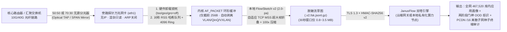

# JanusFlow 核心网 10G / 40G 光纤分光器 (Optical TAP) 与交换机 SPAN 镜像探针 (`probes/core_10g_tap`)

**JanusFlow（雅努斯流 · 官方品牌域名：`janusflow.cn` · `JanusFlow.net` · `atooli.com`）** 核心网万兆分光开源探针套件，专为 **运营商城域网汇聚、高校校园网万兆出口、政企核心交换机光纤分光器（Passive Optical TAP）与端口镜像（SPAN / ERSPAN / VXLAN）** 旁路检测服务器设计。

---

## 一、 核心网 10G 分光旁路接入架构



### 为什么核心网万兆分光必须配合 `tune_10g_tap_nic.sh` 与 `FlowSketch v2 (2.0-pa)`？

1. **防御网卡 `GRO/LRO` 破坏双塔序列特征（Track A）**：
   Linux 万兆网卡驱动（如 Intel `ixgbe` / `i40e`、Mellanox `mlx5_core`）默认开启 `GRO (Generic Receive Offload)`，会将线上连续到达的多个 `1460B` 标准 TCP 报文在驱动层合并为 `8KB~64KB` 的超大巨型帧（Super-Frame），导致加密流量序列塔（Sequence Tower）看到的包长分布失真。
   - **第一道防线（硬件层锁死）**：`tune_10g_tap_nic.sh` 一键执行 `ethtool -K <iface> tso off gso off gro off lro off rxvlan off`，并在每个采集周期自动审计 `ethtool -k` 状态；
   - **第二道防线（算法层自适应折叠）**：即便上游虚拟交换机或 ERSPAN 镜像源无法彻底关闭硬件聚合，内置的 **FlowSketch v2 (`2.0-pa`)** 引擎也能通过单遍扫描双向五元组非巨型帧自动估计每条 TCP 流真实协商的 `est_mss`，在流结算时将 `>1500B` 超大帧精确折叠还原为等效线速 MSS 分段序列！
2. **对称 Toeplitz RSS 队列哈希（Symmetric RSS Hashing）**：
   确保同一条 TCP/UDP 双向五元组的上行包（`c2s`）与下行包（`s2c`）始终落入同一个网卡 RX 队列，避免跨核乱序与双向流割裂。
3. **自动穿透核心网多层隧道封装**：
   `FlowSketch v2` 原生支持在 `snaplen=256` 下自动解封装 **单层 802.1Q VLAN (`0x8100`)**、**双层运营商 QinQ (`0x88A8` / `0x9100`)**、**PPPoE Session (`0x8864`)** 以及 **数据中心 VXLAN (`UDP 4789`)** 内层 IPv4/IPv6 报文。

---

## 二、 三步标准投产 SOP

### 第一步：执行万兆分光镜像网卡一键调优与合规锁死

假设分光器光纤接入探针服务器的万兆网卡 `eth1`（或 `ens2f0`）：

```bash
sudo bash tune_10g_tap_nic.sh eth1
```

该脚本将自动完成：
- 清空镜像口 IP 地址、关闭 ARP、开启混杂只读监听（`promisc on arp off`）；
- 强制关闭 `tso / gso / gro / lro / rxvlan` 卸载；
- 将网卡 RX Ring Buffer 提升至 `4096`；
- 输出 JSON 格式的硬件卸载合规审计回执（`"offload_state": "VERIFIED_OFF"`）。

---

### 第二步：绑定统一 API Key 并启动 10G 分光探针（一钥双服）

> **🔑 统一 API Key 购买与鉴权说明**：
> 核心网 10G 分光探针与 APK 活体动态检测 CLI 共用同一套 API Key 体系。前往官网 [https://www.atooli.com/#pricing](https://www.atooli.com/#pricing) 扫码开通或卡密兑换（推荐 `SUB_MONTH` ¥299/月含 50,000 流/日 + 100 次 PCDN 扫描，或 `SUB_YEAR` ¥2,699/年含 500,000 流/日 + 1,200 次 PCDN 扫描），即可获得 `API Key + Secret` 或一键订阅串 `cp_sub_v1_...`。

#### 方式 A：使用 `janusflow-probe probe-10g-tap` 命令直接启动

```bash
pip install -U "git+https://github.com/876387/janusflow-probe.git"

# 1. 配置统一 API Key 凭据（支持一键导入官网 cp_sub_v1_ 订阅串或显式 Key/Secret）
janusflow-probe auth login --sub cp_sub_v1_xxxxxxxxxxxxxxxx
# 或：
janusflow-probe auth login \
  --endpoint https://www.atooli.com \
  --api-key cnx_live_your_key_id \
  --secret sec_your_hmac_secret

# 2. 运行离线自检（验证 VLAN/VXLAN 解封装、TSO 超大帧自适应 MSS 折叠与 ethtool 校验器）
janusflow-probe probe-10g-tap --self-test

# 3. 启动 10G 分光镜像连续采集（256MB 内核环形缓冲，30秒切片，自动锁定网卡卸载）
sudo -E janusflow-probe probe-10g-tap \
  --iface eth1 \
  --device-id core-tap-10g-hz01 \
  --local-cidr 10.0.0.0/8,100.64.0.0/10 \
  --interval 30 \
  --ring-mb 256 \
  --enforce-offload-off \
  --mode both
```

#### 方式 B：注册为 Linux `systemd` 常驻守护服务 (`janusflow-10g-tap@eth1.service`)

```bash
# 1. 拷贝探针脚本与 systemd 模板
sudo mkdir -p /usr/lib/janusflow/janusflow_probe
sudo cp -f ../../src/janusflow_probe/*.py /usr/lib/janusflow/janusflow_probe/
sudo cp -f core_10g_tap_agent.py /usr/local/bin/janusflow-10g-tap-agent
sudo chmod 0755 /usr/local/bin/janusflow-10g-tap-agent
sudo cp -f tune_10g_tap_nic.sh /usr/local/bin/tune_10g_tap_nic.sh
sudo chmod 0755 /usr/local/bin/tune_10g_tap_nic.sh
sudo cp -f janusflow-10g-tap@.service /etc/systemd/system/

# 2. 写入探针配置文件 /etc/janusflow/tap-eth1.env (0600 权限)
sudo mkdir -p /etc/janusflow
sudo tee /etc/janusflow/tap-eth1.env >/dev/null <<'EOF'
JANUSFLOW_ENDPOINT=https://www.atooli.com
JANUSFLOW_API_KEY=cnx_live_your_key_id
JANUSFLOW_SIGN_SECRET=sec_your_hmac_secret
JANUSFLOW_DEVICE_ID=core-tap-10g-hz01
JANUSFLOW_LOCAL_CIDR=10.0.0.0/8,100.64.0.0/10
JANUSFLOW_INTERVAL=30
JANUSFLOW_RING_MB=256
JANUSFLOW_MODE=both
EOF
sudo chmod 0600 /etc/janusflow/tap-eth1.env

# 3. 启动并设为开机自启
sudo systemctl daemon-reload
sudo systemctl enable --now janusflow-10g-tap@eth1.service
sudo journalctl -u janusflow-10g-tap@eth1.service -f
```

---

### 第三步：对存量超大 PCAP 离线提取 FlowSketch v2 并批量审计

如果核心网已经通过 `tcpdump` 或硬件抓包仪落地了数百 MB 的 `.pcap` / `.pcap.gz` 文件，可直接使用 `janusflow-probe sketch`、`janusflow-probe profile` 或 `janusflow-probe pcdn-scan`：

```bash
# 1. 本地将数百 MB 原始抓包按 FlowSketch v2 (2.0-pa) 提纯压缩为数 MB 的 .v2.fsk.jsonl.gz
janusflow-probe sketch ./core_mirror_10g.pcap -o ./core_mirror_10g.v2.fsk.jsonl.gz

# 2. 提交双塔加密应用识别与多应用混流解复用
janusflow-probe profile ./core_mirror_10g.v2.fsk.jsonl.gz \
  --device-id core-tap-10g-hz01 \
  --local-cidr 10.0.0.0/8,100.64.0.0/10 \
  --format table

# 3. 提交核心网 PCDN 多子网分片分发与上行异常节点扫描
janusflow-probe pcdn-scan ./core_mirror_10g.v2.fsk.jsonl.gz \
  --device-id core-tap-10g-hz01 \
  --local-cidr 10.0.0.0/8,100.64.0.0/10 \
  --format table
```
