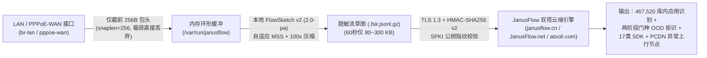

# JanusFlow 边侧 OpenWrt 软路由 / 企业网关轻量流量探针 (`probes/openwrt_edge`)

**JanusFlow（雅努斯流 · 官方品牌域名：`janusflow.cn` · `JanusFlow.net` · `atooli.com`）** 边侧网关开源探针套件，专为 **OpenWrt 软路由（x86_64 / ARM64 Filogic MT7981/MT7986 / Rockchip R2S/R4S/R5S/R6S / 高通 IPQ）** 及 **Linux 园区边缘网关** 设计。

---

## 一、 核心设计优势（为什么能在 128MB 内存路由器上 7×24h 稳定运行？）



1. **零闪存磨损（Zero Flash Wear）**：所有滚动抓包与流草图压缩均在 `/var/run/janusflow` 内存目录内完成，上传后立即 `unlink` 销毁，绝不写入路由器 SPI NAND / eMMC 闪存。
2. **原始载荷不出内网（100x 本地脱敏压缩）**：探针仅截取每包前 `256 Bytes` 头部，并在网关本地通过 **FlowSketch v2 (`2.0-pa`)** 提取五元组、双向包长序列（`seq`，最多 64 包）、首包前 5 包 128B 脱敏握手特征（`pay`）、TLS `SNI/ALPN` 与上下行字节计数。`50 MB` 原始流量在本地压缩为约 `350 KB` 的 `.v2.fsk.jsonl.gz` 后再加密上传。
3. **自动剥离 PPPoE 与 VLAN 标签**：原生支持 OpenWrt `br-lan` 桥接接口、`eth0.x` 802.1Q VLAN 子接口以及 `pppoe-wan` 拨号接口（自动解封装 `0x8864` PPPoE Session 头）。
4. **可选 `nf_conntrack` 字节计数器旁路融合**：自动读取 `/proc/net/nf_conntrack` 双向累计字节数，即使大象流长连接在抓包窗口前已建立握手，也能精准识别 PCDN 持续大上行分片节点。

---

## 二、 统一 API Key 获取与快速接入方式（一钥双服）

> **🔑 统一 API Key 购买与鉴权说明**：
> 边侧 OpenWrt 探针与 APK 活体动态检测 CLI 共用同一套 API Key 体系。前往官网 [https://www.atooli.com/#pricing](https://www.atooli.com/#pricing) 扫码开通或卡密兑换（`PAYG_1` ¥19.9 含 2,000 流/日、`PAYG_10` ¥159 含 15,000 流/日、`SUB_MONTH` ¥299/月含 50,000 流/日 24×7 常驻、`SUB_YEAR` ¥2,699/年含 500,000 流/日），即可获得 `API Key + Secret` 或一键订阅串 `cp_sub_v1_...`。

### 方式 1：在已安装 `janusflow-probe` CLI 的 Linux / OpenWrt x86 网关上一行命令启动

```bash
pip install -U "git+https://github.com/876387/janusflow-probe.git"

# 1. 登录并持久化保存统一 API Key（支持一键导入官网 cp_sub_v1_ 订阅串或显式 Key/Secret）
janusflow-probe auth login --sub cp_sub_v1_xxxxxxxxxxxxxxxx
# 或：
janusflow-probe auth login \
  --endpoint https://www.atooli.com \
  --api-key cnx_live_your_key_id \
  --secret sec_your_hmac_secret

# 2. 先跑一次本地离线自检（验证 FlowSketch v2 提取与 TSO 折叠正常）
janusflow-probe probe-openwrt --self-test

# 3. 启动边侧网关连续 60 秒时间窗探针（同时输出双塔应用识别 + PCDN 扫描）
janusflow-probe probe-openwrt \
  --iface br-lan \
  --device-id openwrt-office-gw01 \
  --local-cidr 10.0.0.0/8 \
  --interval 60 \
  --mode both
```

---

### 方式 2：在轻量级嵌入式 OpenWrt 路由器上使用一键安装脚本 (`procd` 守护)

适用于存储空间有限的 ARM64 / MIPS / x86 OpenWrt 软路由（仅依赖 `python3-light`、`python3-openssl`、`tcpdump-mini`）：

```bash
# SSH 登录 OpenWrt 路由器后执行：
sh install_openwrt_probe.sh \
  --endpoint https://www.atooli.com \
  --api-key cnx_live_your_key_id \
  --secret sec_your_hmac_secret \
  --iface br-lan \
  --device-id openwrt-branch-01 \
  --local-cidr 10.0.0.0/8 \
  --interval 60
```

安装完成后可通过 OpenWrt 标准 `service` 命令管理：

```bash
/etc/init.d/janusflow-probe status
/etc/init.d/janusflow-probe restart
logread -f -e janusflow-probe
```

---

### 方式 3：单文件独立运行 (`openwrt_probe_agent.py`)

如果您希望通过 `cron` 定时任务或自定义脚本按需触发单次抓包识别：

```bash
# 离线自检
python3 openwrt_probe_agent.py --self-test

# 单次采集 br-lan 60 秒并上报双塔流量识别与 PCDN 拓扑检测
export JANUSFLOW_API_KEY="cnx_live_your_key_id"
export JANUSFLOW_SIGN_SECRET="sec_your_hmac_secret"
python3 openwrt_probe_agent.py \
  --iface br-lan \
  --device-id openwrt-gw-01 \
  --local-cidr 10.0.0.0/8 \
  --interval 60 \
  --include-conntrack \
  --once
```

---

## 三、 查询边侧探针历史应用画像与 PCDN 时间线

在任意运维终端上使用 `janusflow-probe timeline` 即可聚合查看指定 OpenWrt 探针过去 1 小时~24 小时的活跃应用与异常 PCDN 终端：

```bash
# 查看该网关过去 1 小时识别到的活跃加密应用与第三方 SDK 汇总
janusflow-probe timeline --device-id openwrt-branch-01 --window 3600 --format table

# 仅查看该网关命中 PCDN 多子网分片上行特征的异常内网终端台账
janusflow-probe timeline --device-id openwrt-branch-01 --window 3600 --pcdn-only --format table
```
